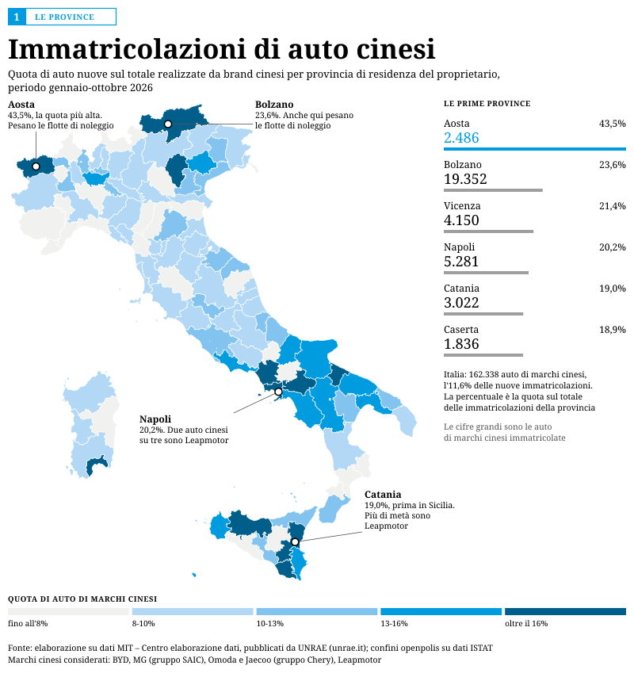

# Auto di marchi cinesi per provincia (gennaio-ottobre 2026)

Quota di auto nuove di marchi cinesi sul totale delle immatricolazioni, per provincia di residenza del proprietario.



## Risultati principali

- Italia, gennaio-ottobre 2026: 162.344 auto di marchi cinesi, l'11,6% delle immatricolazioni (5,7% nello stesso periodo del 2025).
- Quote più alte: Aosta (43,5%), Bolzano (23,6%), Vicenza (21,4%), Napoli (20,2%). Aosta e Bolzano risentono delle flotte di noleggio intestate alla sede della società.
- Sud e Isole: 14,1%, contro l'11,1% del Centro-Nord. Il divario dipende quasi solo da Leapmotor, concentrato tra febbraio e giugno.

## Marchi cinesi considerati

BYD (gruppo BYD), MG (gruppo SAIC), Omoda e Jaecoo (gruppo Chery), Leapmotor. Sono gli unici con una voce propria nei dati per provincia. I marchi cinesi minori (Geely, Dongfeng, Lynk & Co, Deepal, Xpeng e altri) rientrano nella voce «Altre», meno dell'1% del mercato. Esclusi DR/EVO ed EMC, marchi italiani che vendono auto prodotte in Cina.

## Fonti

- Dati: MIT – Centro elaborazione dati, «Immatricolazioni di autovetture per provincia di residenza del proprietario», PDF mensili pubblicati da [UNRAE](https://www.unrae.it/dati-statistici/immatricolazioni).
- Serie storica nazionale: UNRAE, «Immatricolazioni di autovetture per marca», file di ottobre 2013-2026.
- Confini: [openpolis/geojson-italy](https://github.com/openpolis/geojson-italy), versione 2023 con le 107 province usate dal MIT.

## Metodo

1. I 10 PDF mensili (gennaio-ottobre 2026) sono stati scaricati dal sito UNRAE.
2. `src/estrai_pdf.py` legge le tabelle dai PDF: colonne ricavate dall'allineamento dei numeri, nomi dei marchi dall'intestazione. Ogni riga è verificata (somma dei marchi = totale della provincia) e ogni colonna (somma delle province = totale nazionale).
3. `src/unisci_mesi.py` unisce i mesi in `dati/immatricolazioni_provincia_marca_gen-ott2026_long.csv` (mese × provincia × marca) e nel cumulato.
4. `src/quota_province.py` calcola la quota per provincia (`dati/quota_auto_cinesi_province_gen-ott2026.csv`).
5. `src/mappa.py` disegna la mappa SVG.

Nota: nel PDF di febbraio 2026 la riga TOTALE non riporta Leapmotor (5.008 auto); il totale nazionale è ricalcolato dalla somma delle province.

## Come rigenerare la mappa

```
pip install -r requirements.txt
python src/mappa.py dati/quota_auto_cinesi_province_gen-ott2026.csv dati/province_2023.geojson output/mappa_auto_cinesi_province_gen-ott2026.svg
```

Testi, classi, colori e richiami sono costanti in cima a `src/mappa.py` (`TITOLO`, `STOPS`, `RICHIAMI`...).

## Embed

```html
<object data="https://cosimofire.github.io/auto-cinesi-province/output/mappa_auto_cinesi_province_gen-ott2026.svg"
  type="image/svg+xml" aria-label="Immatricolazioni di auto cinesi per provincia, gennaio-ottobre 2026"
  style="width:100%;max-width:800px;aspect-ratio:800/974;display:block;margin:0 auto;border:0"></object>
```

Il tooltip funziona con `<object>` o `<iframe>`, non con ``.

Per rifare l'estrazione dai PDF, scaricare i file mensili in una cartella (es. `pdf/`) e lanciare:

```
python src/unisci_mesi.py pdf .
python src/quota_province.py immatricolazioni_provincia_marca_gen-ott2026_cumulato.csv quota_auto_cinesi_province_gen-ott2026.csv
```
